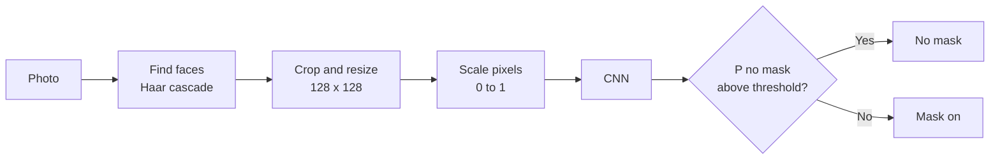

<div align="center">

# 😷 Mask Check

### Deep learning face mask detection, from raw dataset to live web app

Upload a photo or use your camera. The app finds every face and tells you whether a mask is on, with a confidence score for each one.

<br>

[](https://face-mask-detection-muvcrwqe4ny3jdwmgt2pz3.streamlit.app/)


</div>

---

## Table of Contents

- [Overview](#overview)
- [Features](#features)
- [How It Works](#how-it-works)
- [Dataset](#dataset)
- [Model Architecture](#model-architecture)
- [Training Setup](#training-setup)
- [Project Structure](#project-structure)
- [Run It Locally](#run-it-locally)
- [Deploy on Streamlit Cloud](#deploy-on-streamlit-cloud)
- [Troubleshooting](#troubleshooting)
- [Limitations](#limitations)
- [Future Improvements](#future-improvements)
- [Acknowledgements](#acknowledgements)

---

## Overview

Mask Check is an end-to-end computer vision project. It covers every stage of a real deep learning workflow:

1. Preprocessing an image dataset
2. Building and training a convolutional neural network (CNN)
3. Evaluating it on unseen data
4. Packaging the trained model into a polished web app anyone can use

The CNN is trained from scratch in Google Colab, then served through a Streamlit interface that detects faces with OpenCV and classifies each one as **Mask** or **No mask**.

## Features

| | Feature | Details |
|---|---|---|
| 📷 | **Two input modes** | Upload an image (JPG, PNG) or take a photo with your camera |
| 👥 | **Multi-face detection** | Every face in a photo is found and classified separately |
| 🎯 | **Confidence rings** | Each face gets a verdict card with a confidence percentage |
| 📊 | **Summary bar** | A quick green/red split shows how many faces have a mask |
| 🎚️ | **Adjustable threshold** | Change the decision threshold and see how predictions shift |
| 🔁 | **Face detection toggle** | Turn it off for close-up face photos like the training images |
| 📱 | **Phone-friendly** | Photo rotation is corrected and large images are resized automatically |

## How It Works



1. **Find faces.** OpenCV's Haar cascade locates each face. If none is found, the whole photo is checked instead.
2. **Prepare each face.** Every crop is converted to RGB, resized to 128×128 and scaled to the 0–1 range, exactly like the training data. This match is what keeps predictions reliable.
3. **Classify.** The CNN outputs the probability of *no mask*. The threshold (0.5 by default) turns that into a verdict.

## Dataset

- **Source:** [Face Mask Dataset on Kaggle](https://www.kaggle.com/datasets/omkargurav/face-mask-dataset)
- **Size:** roughly 7,500 images
- **Classes:** `with_mask` (label 0) and `without_mask` (label 1)

### Preprocessing pipeline

| Step | What happens | Why it matters |
|---|---|---|
| Load | Images read with OpenCV and converted from BGR to RGB | OpenCV reads BGR by default, but the model expects RGB |
| Resize | Every image becomes 128×128 | Neural networks need fixed-size inputs |
| Inspect | Random samples and class counts are plotted | Catches wrong labels and class imbalance early |
| Split | 70% train, 15% validation, 15% test, stratified | The test set stays unseen until the final evaluation |
| Normalize | Pixel values scaled from 0–255 to 0–1 | Makes gradient descent faster and more stable |
| Augment | Random flip, rotation, zoom and contrast (training only) | Helps the model generalize instead of memorizing |

## Model Architecture

A compact CNN built with Keras. Each convolution block learns richer features than the one before: edges, then textures, then face and mask parts.

| Stage | Layers | Purpose |
|---|---|---|
| Input | 128 × 128 × 3 image | Normalized RGB face |
| Augmentation | Flip, rotation, zoom, contrast | Active during training only |
| Block 1 | Conv2D (32) → BatchNorm → MaxPool | Low-level features |
| Block 2 | Conv2D (64) → BatchNorm → MaxPool | Mid-level features |
| Block 3 | Conv2D (128) → BatchNorm → MaxPool | High-level features |
| Head | GlobalAveragePooling → Dense (128) → Dropout (0.5) | Compress and classify |
| Output | Dense (1) with sigmoid | Probability of *no mask* |

## Training Setup

| Setting | Value |
|---|---|
| Loss | Binary cross-entropy |
| Optimizer | Adam, learning rate 1e-3 |
| Batch size | 32 |
| Max epochs | 25 to 40 |
| Callbacks | `EarlyStopping` (restores best weights), `ModelCheckpoint`, `ReduceLROnPlateau` |
| Evaluation | Accuracy, precision, recall, F1-score and a confusion matrix on the held-out test set |

> **Tip:** training stopping before the maximum epoch is expected. `EarlyStopping` ends training when validation loss stops improving and keeps the best weights.

## Project Structure

```
face-mask-detection/
├── app.py                  # Streamlit web app (UI, face detection, prediction)
├── face_mask_model.keras   # Trained CNN exported from Colab
├── requirements.txt        # Python dependencies
├── .streamlit/
│   └── config.toml         # Light theme settings
└── README.md
```

## Run It Locally

**Prerequisites:** Python 3 and Git.

```bash
# 1. Clone the repository
git clone https://github.com/Zeeshan608/face-mask-detection.git
cd face-mask-detection

# 2. Create and activate a virtual environment
python -m venv .venv
.venv\Scripts\activate          # Windows
source .venv/bin/activate       # macOS / Linux

# 3. Install dependencies
pip install -r requirements.txt

# 4. Launch the app
streamlit run app.py
```

The app opens at `http://localhost:8501`.

## Deploy on Streamlit Cloud

1. Push this repository to GitHub (public).
2. Go to [share.streamlit.io](https://share.streamlit.io) and sign in with GitHub.
3. Click **Create app** and select this repository.
4. Set the branch to `main` and the main file path to `app.py`.
5. Open **Advanced settings** and choose the same Python version you developed with.
6. Click **Deploy**.

## Troubleshooting

| Problem | Likely cause | Fix |
|---|---|---|
| Model fails to load | The TensorFlow version differs from the one used in Colab | Install the TensorFlow version that Colab printed (`tf.__version__`) |
| `AttributeError` on `cv2.CascadeClassifier` | Conflicting or broken OpenCV install | Keep only `opencv-python-headless` in `requirements.txt`, then delete and redeploy the app |
| Face not detected | Haar cascade struggles with partly covered or angled faces | Use a clear, front-facing, well-lit photo, or turn off **Find faces first** for close-ups |
| Poor results on your own photos | Dataset photos look different from real-world photos | See [Future Improvements](#future-improvements) |

## Limitations

- The model is trained on one public dataset, so accuracy can drop on photos with unusual lighting, angles or masks.
- The Haar cascade face detector is lightweight but less reliable than modern detectors, especially when a mask covers the lower face.
- This is a learning project. Its predictions are estimates and must not be used for safety, security or compliance decisions.

## Future Improvements

- [ ] Replace the CNN with transfer learning (MobileNetV2) for higher accuracy on real-world photos
- [ ] Swap the Haar cascade for a stronger face detector (for example MediaPipe or a DNN-based detector)
- [ ] Add real-time webcam video with `streamlit-webrtc`
- [ ] Add a third class for incorrectly worn masks
- [ ] Track experiments and compare different augmentation settings

## Acknowledgements

- Dataset: [omkargurav/face-mask-dataset](https://www.kaggle.com/datasets/omkargurav/face-mask-dataset) on Kaggle. Please check its page for usage terms.
- Built with [TensorFlow](https://www.tensorflow.org/), [OpenCV](https://opencv.org/) and [Streamlit](https://streamlit.io/).

---

<div align="center">

**Built by [Zeeshan Ahmad](https://github.com/Zeeshan608)**

If this project helped you learn something, consider giving it a ⭐

</div>
